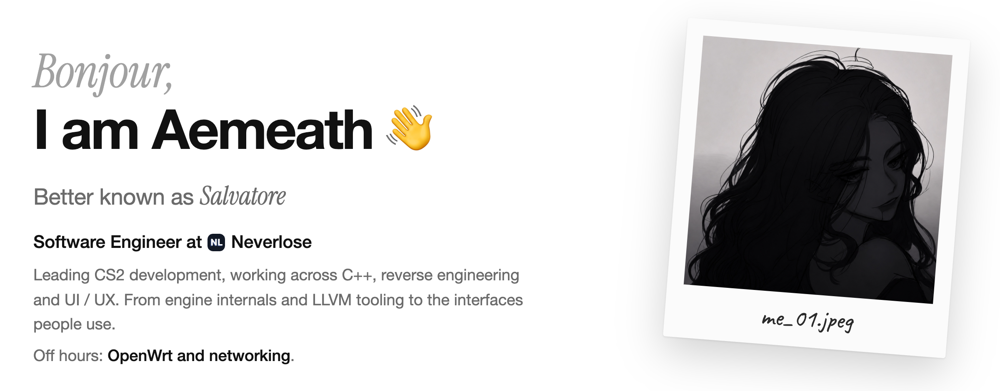
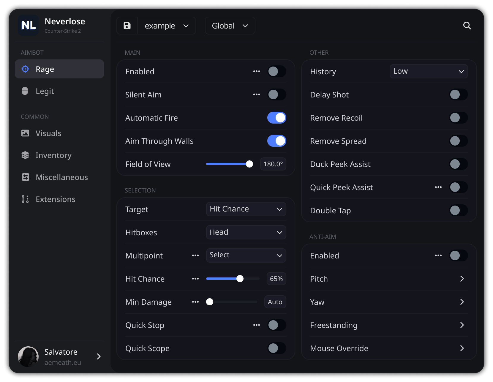
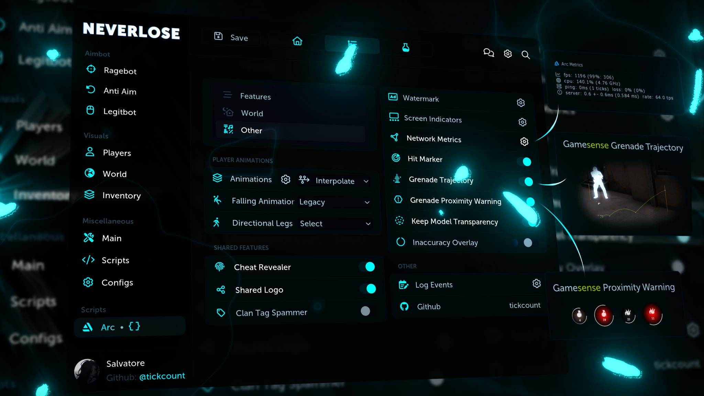

<a href="https://aemeath.eu">
  <picture>
    <source media="(prefers-color-scheme: dark)" srcset="assets/hero-dark.png">
    
  </picture>
</a>

<a href="https://aemeath.eu"><picture><source media="(prefers-color-scheme: dark)" srcset="https://shieldcn.dev/badge/About%20Me.svg?variant=secondary&font=geist&logo=lu:Globe&mode=dark"></picture></a>
<a href="https://x.com/aemeathless"><picture><source media="(prefers-color-scheme: dark)" srcset="https://shieldcn.dev/badge/X.svg?variant=secondary&font=geist&logo=x&mode=dark"></picture></a>
<a href="https://youtube.com/@aemeathless"><picture><source media="(prefers-color-scheme: dark)" srcset="https://shieldcn.dev/badge/YouTube.svg?variant=secondary&font=geist&logo=youtube&mode=dark"></picture></a>
<a href="https://www.instagram.com/aemeathless"><picture><source media="(prefers-color-scheme: dark)" srcset="https://shieldcn.dev/badge/Instagram.svg?variant=secondary&font=geist&logo=instagram&mode=dark"></picture></a>
<a href="https://steamcommunity.com/profiles/76561198865965988"><picture><source media="(prefers-color-scheme: dark)" srcset="https://shieldcn.dev/badge/Steam.svg?variant=secondary&font=geist&logo=steam&mode=dark"></picture></a>
<a href="https://discord.com/users/262604446821908480"><picture><source media="(prefers-color-scheme: dark)" srcset="https://shieldcn.dev/badge/Discord.svg?variant=secondary&font=geist&logo=discord&mode=dark"></picture></a>

 

## 💼 Work

<table>
  <tr>
    <td width="52%" valign="top"></td>
    <td width="48%" valign="top">
      <h3>Neverlose CS2</h3>
      
2024 – present

      
C++ development and technical leadership for Neverlose's CS2 product: Source&nbsp;2 internals, features, visual and UI systems, LLVM / Clang compiler engineering, software protection and internal tooling.

      
<a href="https://neverlose.cc">neverlose.cc →</a>

    </td>
  </tr>
</table>

### Dawnline & Outline 2026

Two LuCI projects for OpenWrt.

<table>
  <tr>
    <td width="50%" valign="top">
      
      
<b><a href="https://github.com/tickcount/luci-app-dawnline">Dawnline</a></b> <a href="https://github.com/tickcount/luci-app-dawnline/stargazers"><picture><source media="(prefers-color-scheme: dark)" srcset="https://shieldcn.dev/github/stars/tickcount/luci-app-dawnline.svg?variant=secondary&font=geist&size=xs&mode=dark"></picture></a> Turns a router into a private AmneziaWG VPN: a personal portal for every person, access rules and limits.

    </td>
    <td width="50%" valign="top">
      
      
<b><a href="https://github.com/tickcount/luci-theme-outline">Outline</a></b> <a href="https://github.com/tickcount/luci-theme-outline/stargazers"><picture><source media="(prefers-color-scheme: dark)" srcset="https://shieldcn.dev/github/stars/tickcount/luci-theme-outline.svg?variant=secondary&font=geist&size=xs&mode=dark"></picture></a> A ChatGPT-style LuCI theme: a command palette, theme presets and no-reload navigation.

    </td>
  </tr>
</table>

<b>Lua libraries &amp; interfaces</b> CS:GO

 

<table>
  <tr>
    <td width="48%" valign="top">
      
Earlier CS:GO work on native FFI integration, game-system research, animation and interface design: Solus UI, Arc Project and the libraries below.

      

        <a href="https://github.com/tickcount/voice-listener.lua"><b>voice-listener.lua</b></a> <a href="https://github.com/tickcount/voice-listener.lua/stargazers"><picture><source media="(prefers-color-scheme: dark)" srcset="https://shieldcn.dev/github/stars/tickcount/voice-listener.lua.svg?variant=secondary&font=geist&size=xs&mode=dark"></picture></a> 
        <a href="https://github.com/tickcount/lagrecord-csgo.lua"><b>lagrecord-csgo.lua</b></a> <a href="https://github.com/tickcount/lagrecord-csgo.lua/stargazers"><picture><source media="(prefers-color-scheme: dark)" srcset="https://shieldcn.dev/github/stars/tickcount/lagrecord-csgo.lua.svg?variant=secondary&font=geist&size=xs&mode=dark"></picture></a> 
        <a href="https://github.com/tickcount/smoothy.lua"><b>smoothy.lua</b></a> <a href="https://github.com/tickcount/smoothy.lua/stargazers"><picture><source media="(prefers-color-scheme: dark)" srcset="https://shieldcn.dev/github/stars/tickcount/smoothy.lua.svg?variant=secondary&font=geist&size=xs&mode=dark"></picture></a> 
        <a href="https://github.com/tickcount/.ssh"><b>.ssh</b></a> <a href="https://github.com/tickcount/.ssh/stargazers"><picture><source media="(prefers-color-scheme: dark)" srcset="https://shieldcn.dev/github/stars/tickcount/.ssh.svg?variant=secondary&font=geist&size=xs&mode=dark"></picture></a> 
        <a href="https://github.com/tickcount/gamesense-csgo"><b>gamesense-csgo</b></a> <a href="https://github.com/tickcount/gamesense-csgo/stargazers"><picture><source media="(prefers-color-scheme: dark)" srcset="https://shieldcn.dev/github/stars/tickcount/gamesense-csgo.svg?variant=secondary&font=geist&size=xs&mode=dark"></picture></a>
      

    </td>
    <td width="52%" valign="top"></td>
  </tr>
</table>

<b>Also in the open</b>

 

<table>
  <tr>
    <td><a href="https://github.com/tickcount/openwrt-mole"><b>Mole</b></a> <a href="https://github.com/tickcount/openwrt-mole/stargazers"><picture><source media="(prefers-color-scheme: dark)" srcset="https://shieldcn.dev/github/stars/tickcount/openwrt-mole.svg?variant=secondary&font=geist&size=xs&mode=dark"></picture></a></td>
    <td>Proxy subscription manager for Podkop on OpenWrt routers</td>
  </tr>
  <tr>
    <td><a href="https://github.com/tickcount/iplists"><b>iplists</b></a> <a href="https://github.com/tickcount/iplists/stargazers"><picture><source media="(prefers-color-scheme: dark)" srcset="https://shieldcn.dev/github/stars/tickcount/iplists.svg?variant=secondary&font=geist&size=xs&mode=dark"></picture></a></td>
    <td>Domain and IP rule sets for sing-box, from public sources</td>
  </tr>
  <tr>
    <td><a href="https://github.com/tickcount/hitsounds"><b>hitsounds</b></a> <a href="https://github.com/tickcount/hitsounds/stargazers"><picture><source media="(prefers-color-scheme: dark)" srcset="https://shieldcn.dev/github/stars/tickcount/hitsounds.svg?variant=secondary&font=geist&size=xs&mode=dark"></picture></a></td>
    <td>Hit marker sounds for Counter-Strike 2</td>
  </tr>
  <tr>
    <td><a href="https://github.com/tickcount/.p2c-icons"><b>p2c-icons</b></a> <a href="https://github.com/tickcount/.p2c-icons/stargazers"><picture><source media="(prefers-color-scheme: dark)" srcset="https://shieldcn.dev/github/stars/tickcount/.p2c-icons.svg?variant=secondary&font=geist&size=xs&mode=dark"></picture></a></td>
    <td>An icon set first made for the Cheat Revealer</td>
  </tr>
  <tr>
    <td><a href="https://github.com/tickcount/openwrt-liminal"><b>Liminal</b></a> <a href="https://github.com/tickcount/openwrt-liminal/stargazers"><picture><source media="(prefers-color-scheme: dark)" srcset="https://shieldcn.dev/github/stars/tickcount/openwrt-liminal.svg?variant=secondary&font=geist&size=xs&mode=dark"></picture></a></td>
    <td>A menu-driven AmneziaWG tunnel manager, now replaced by Dawnline</td>
  </tr>
</table>

## 🧱 Stack

<table>
  <tr>
    <td><b>Languages</b></td>
    <td><a href="https://en.cppreference.com/w/c"><picture><source media="(prefers-color-scheme: dark)" srcset="https://shieldcn.dev/badge/C.svg?variant=secondary&font=geist&logo=c&mode=dark"></picture></a> <a href="https://isocpp.org/"><picture><source media="(prefers-color-scheme: dark)" srcset="https://shieldcn.dev/badge/C%2B%2B.svg?variant=secondary&font=geist&logo=cplusplus&mode=dark"></picture></a> <a href="https://luajit.org/"><picture><source media="(prefers-color-scheme: dark)" srcset="https://shieldcn.dev/badge/Lua%20%2F%20LuaJIT.svg?variant=secondary&font=geist&logo=lua&mode=dark"></picture></a> <a href="https://www.typescriptlang.org/"><picture><source media="(prefers-color-scheme: dark)" srcset="https://shieldcn.dev/badge/TypeScript.svg?variant=secondary&font=geist&logo=typescript&mode=dark"></picture></a> <a href="https://developer.mozilla.org/docs/Web/JavaScript"><picture><source media="(prefers-color-scheme: dark)" srcset="https://shieldcn.dev/badge/JavaScript.svg?variant=secondary&font=geist&logo=javascript&mode=dark"></picture></a></td>
  </tr>
  <tr>
    <td><b>Compilers</b></td>
    <td><a href="https://llvm.org/"><picture><source media="(prefers-color-scheme: dark)" srcset="https://shieldcn.dev/badge/LLVM%20%2F%20Clang.svg?variant=secondary&font=geist&logo=llvm&mode=dark"></picture></a></td>
  </tr>
  <tr>
    <td><b>Reverse engineering</b></td>
    <td><a href="https://hex-rays.com/ida-pro"><picture><source media="(prefers-color-scheme: dark)" srcset="https://shieldcn.dev/badge/IDA%20Pro.svg?variant=secondary&font=geist&logo=lu:Microscope&mode=dark"></picture></a> <a href="https://binary.ninja/"><picture><source media="(prefers-color-scheme: dark)" srcset="https://shieldcn.dev/badge/Binary%20Ninja.svg?variant=secondary&font=geist&logo=lu:Binary&mode=dark"></picture></a> <a href="https://x64dbg.com/"><picture><source media="(prefers-color-scheme: dark)" srcset="https://shieldcn.dev/badge/x64dbg.svg?variant=secondary&font=geist&logo=lu:Bug&mode=dark"></picture></a> <a href="https://www.cheatengine.org/"><picture><source media="(prefers-color-scheme: dark)" srcset="https://shieldcn.dev/badge/Cheat%20Engine.svg?variant=secondary&font=geist&logo=lu:Cpu&mode=dark"></picture></a> <a href="https://github.com/ReClassNET/ReClass.NET"><picture><source media="(prefers-color-scheme: dark)" srcset="https://shieldcn.dev/badge/ReClass.NET.svg?variant=secondary&font=geist&logo=lu:Boxes&mode=dark"></picture></a> <a href="https://vmpsoft.com/"><picture><source media="(prefers-color-scheme: dark)" srcset="https://shieldcn.dev/badge/VMProtect.svg?variant=secondary&font=geist&logo=lu:ShieldCheck&mode=dark"></picture></a></td>
  </tr>
  <tr>
    <td><b>Graphics &amp; UI</b></td>
    <td><a href="https://learn.microsoft.com/windows/win32/directx"><picture><source media="(prefers-color-scheme: dark)" srcset="https://shieldcn.dev/badge/DirectX.svg?variant=secondary&font=geist&logo=lu:Box&mode=dark"></picture></a> <a href="https://learn.microsoft.com/windows/win32/direct3dhlsl/dx-graphics-hlsl"><picture><source media="(prefers-color-scheme: dark)" srcset="https://shieldcn.dev/badge/HLSL.svg?variant=secondary&font=geist&logo=lu:Blend&mode=dark"></picture></a> <a href="https://github.com/ocornut/imgui"><picture><source media="(prefers-color-scheme: dark)" srcset="https://shieldcn.dev/badge/ImGui.svg?variant=secondary&font=geist&logo=lu:AppWindow&mode=dark"></picture></a> <a href="https://www.figma.com/"><picture><source media="(prefers-color-scheme: dark)" srcset="https://shieldcn.dev/badge/Figma.svg?variant=secondary&font=geist&logo=figma&mode=dark"></picture></a> <a href="https://tailwindcss.com/"><picture><source media="(prefers-color-scheme: dark)" srcset="https://shieldcn.dev/badge/Tailwind%20CSS.svg?variant=secondary&font=geist&logo=tailwindcss&mode=dark"></picture></a> <a href="https://vite.dev/"><picture><source media="(prefers-color-scheme: dark)" srcset="https://shieldcn.dev/badge/Vite.svg?variant=secondary&font=geist&logo=vite&mode=dark"></picture></a></td>
  </tr>
  <tr>
    <td><b>AI</b></td>
    <td><a href="https://claude.ai/"><picture><source media="(prefers-color-scheme: dark)" srcset="https://shieldcn.dev/badge/Claude.svg?variant=secondary&font=geist&logo=claude&mode=dark"></picture></a> <a href="https://openai.com/codex/"><picture><source media="(prefers-color-scheme: dark)" srcset="https://shieldcn.dev/badge/ChatGPT%20Codex.svg?variant=secondary&font=geist&logo=ri:RiOpenaiFill&mode=dark"></picture></a></td>
  </tr>
  <tr>
    <td><b>Everyday</b></td>
    <td><a href="https://git-scm.com/"><picture><source media="(prefers-color-scheme: dark)" srcset="https://shieldcn.dev/badge/Git.svg?variant=secondary&font=geist&logo=git&mode=dark"></picture></a> <a href="https://www.kernel.org/"><picture><source media="(prefers-color-scheme: dark)" srcset="https://shieldcn.dev/badge/Linux.svg?variant=secondary&font=geist&logo=linux&mode=dark"></picture></a> <a href="https://openwrt.org/"><picture><source media="(prefers-color-scheme: dark)" srcset="https://shieldcn.dev/badge/OpenWrt.svg?variant=secondary&font=geist&logo=openwrt&mode=dark"></picture></a></td>
  </tr>
</table>

Plus Source&nbsp;2 internals, software protection and networking.

## 📊 A year of code

---

Thanks for stopping by · <a href="https://aemeath.eu">aemeath.eu</a>

